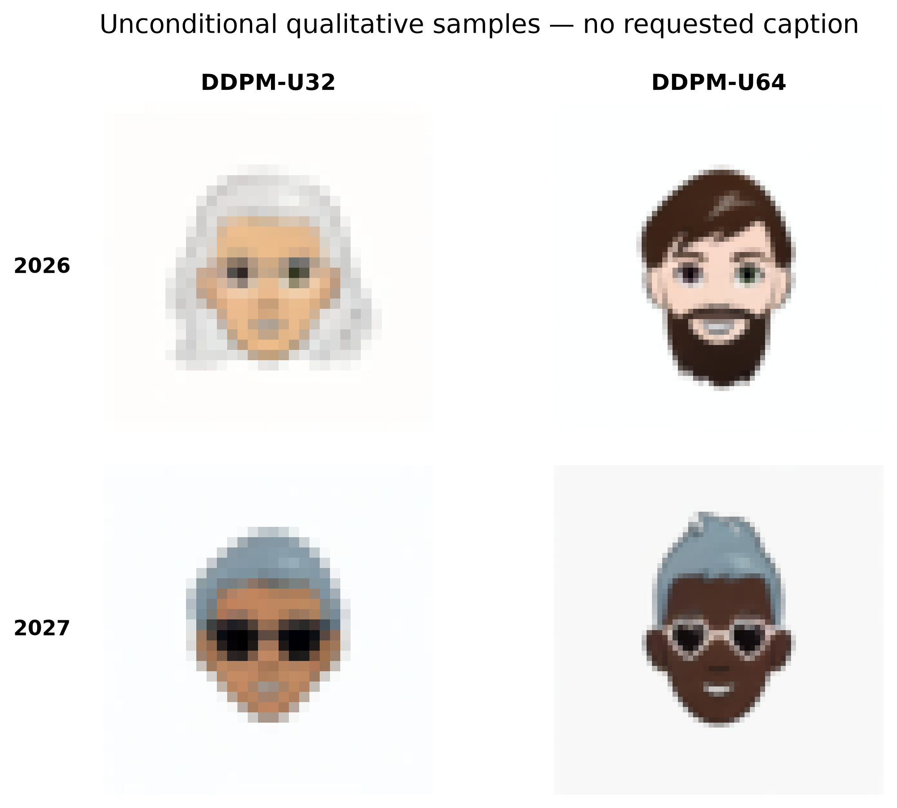
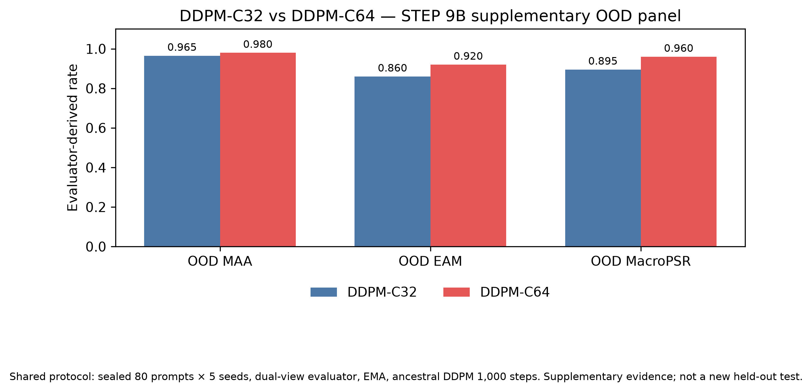
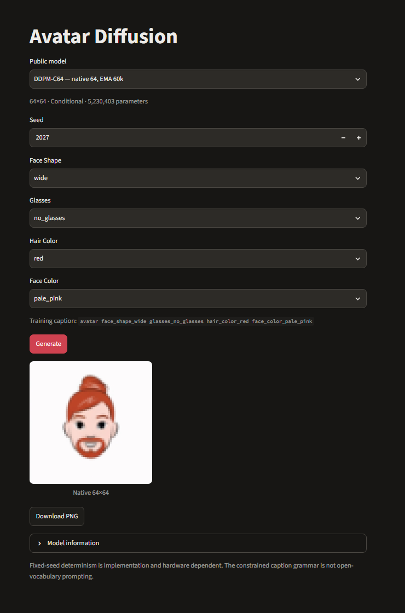

# Tiny Avatar Diffusion

[](https://github.com/BartoloMorgigno11/tiny-avatar-diffusion/actions/workflows/public-release.yml)

Course project for the **Deep Learning 2026** exam. This repository implements pixel-space denoising diffusion models from scratch for CartoonSet-style avatar generation. The examination question is whether a compact model can generate avatars that follow a structured four-attribute text prompt, while making the limits of the evaluation explicit.

The exam submission is preserved by the immutable Git tag [`exam-submission-d8a0cdf`](../../tree/exam-submission-d8a0cdf). The public release provides four authenticated inference checkpoints, a compact verification suite, professor-facing notebooks, and a Streamlit demonstration.

## Visual snapshots

<table>
  <tr>
    <td width="50%" valign="top">
      
      <p align="center"><em>Qualitative samples from the two unconditional release models.</em></p>
    </td>
    <td width="50%" valign="top">
      
      <p align="center"><em>Frozen conditional OOD evaluation under the documented shared protocol.</em></p>
    </td>
  </tr>
</table>

The figures are release evidence, not a claim of open-vocabulary generation or clinical/production-grade image quality. See the final notebooks and [`REPRODUCIBILITY.md`](REPRODUCIBILITY.md) for the complete protocols and interpretation limits.

## Interactive demonstration

<p align="center">
  
</p>

The local Streamlit demonstration exposes the public DDPM-C64 conditional model, its fixed attribute grammar, and a generated sample. It is an inference demonstration, not a benchmark runner; see the [demo instructions](#four-model-streamlit-demonstration) for setup.

## Public model family

All endpoints use a compact U-Net denoiser, epsilon prediction, and a 1,000-step linear ancestral DDPM. Conditional models add a scratch-trained Transformer text encoder and cross-attention at the 8x8 and 16x16 stages.

| Public model | Native resolution | Conditioning | Released weights |
|---|---:|---|---|
| DDPM-U32 | 32x32 | Unconditional | EMA 40k |
| DDPM-C32 | 32x32 | Text-conditioned | EMA 40k |
| DDPM-U64 | 64x64 | Unconditional | EMA 60k |
| DDPM-C64 | 64x64 | Text-conditioned | EMA 60k |

The canonical paths, architecture metadata, adapters, and SHA-256 identities are in [`src/tiny_avatar_diffusion/public_model_manifest.json`](src/tiny_avatar_diffusion/public_model_manifest.json).

## Scientific scope

Prompts use the fixed grammar `avatar <face_shape> <glasses> <hair_color> <face_color>`. The project evaluates conditional adherence, distributional quality, diversity, and efficiency under frozen, named protocols.

Conditional adherence is estimated by an independent classifier and is not a human evaluation or calibrated probability of correctness. Conditional and unconditional metrics use different estimands; they must not be collapsed into a single four-model ranking. Full training and metric recomputation require external CartoonSet archives, CUDA resources, and—in some historical workflows—full-state checkpoints that are not distributed here.

## Results at a glance (frozen evidence)

The following values are read from the versioned frozen records; they are not recomputed by the public quickstart.
They are presented in two tables because conditional structured-prompt generation and unconditional marginal
sampling answer different questions.

**Conditional endpoints.** The 80-prompt × five-seed panel is an authenticated *supplementary* application of a
frozen protocol, not a new independent held-out test. KID/FID use the documented Common-32 route; FID is
exploratory.

| Endpoint | Common-32 KID | Common-32 FID† | OOD MAA | EAM | MacroPSR |
|---|---:|---:|---:|---:|---:|
| DDPM-C32 (H7, EMA 40k) | 0.010000 | 59.430 | 0.965 | 0.860 | 0.895 |
| DDPM-C64 (V2-A, EMA 60k) | 0.016694 | 65.007 | 0.980 | 0.920 | 0.960 |

**Unconditional endpoints.** Completed STEP 13 uses 400 generated samples, an 808-image real reference pool,
and 200 deterministic marginal LPIPS pairs. MAA, EAM, and MacroPSR are undefined because no structured request is
supplied.

| Endpoint | Common-32 KID | Common-32 FID† | Marginal LPIPS |
|---|---:|---:|---:|
| DDPM-U32 (EMA 40k) | 0.008134 | 41.547 | 0.088892 |
| DDPM-U64 (EMA 60k) | 0.009724 | 47.215 | 0.234633 |

† Common-32 downscales native 64×64 outputs through the recorded LANCZOS route; it does not measure native-detail
superiority. Conditional LPIPS (within-prompt, across seeds) and unconditional marginal LPIPS are different
estimands, so neither table supports a cross-mode or cross-resolution ranking. Sources:
[`results/runs/v2a_step9b_final_supplementary_ema60k_v1/`](results/runs/v2a_step9b_final_supplementary_ema60k_v1/),
[`results/runs/step13_final_unconditional_benchmark_v1/summary.json`](results/runs/step13_final_unconditional_benchmark_v1/summary.json),
and the final notebooks.

## Install

> **Security notice — historical dependency:** The current release pins `torch==2.5.1`, which is affected by [CVE-2025-32434](https://github.com/pytorch/pytorch/security/advisories/GHSA-53q9-r3pm-6pq6), including when `weights_only=True` is used. Do not load untrusted checkpoints. Verify the SHA-256 hashes of the distributed artifacts against a trusted copy of the manifest and use an isolated environment without sensitive data or credentials. Hash verification establishes integrity against that manifest, not absolute safety. Migration to a patched, supported PyTorch version requires separate compatibility and regression checks; this notice is not a vulnerability fix.


Use CPython 3.11 or 3.12 for the verified installation path. The pinned `torch==2.5.1` dependency does not provide
an installation path for every newer Python release. Minimal public inference needs only the core dependencies:

```powershell
python -m venv .venv
.venv\Scripts\Activate.ps1
python -m pip install --upgrade pip
python -m pip install -e .
tiny-avatar-public --help
```

Optional extras are installed only for the corresponding activity:

```powershell
# Four scientific notebooks
python -m pip install -e ".[notebook]"

# Streamlit demonstration
python -m pip install -e ".[demo]"

# Selected tests and development tools
python -m pip install -e ".[dev]"

# Historical evaluation tooling; not needed for public inference
python -m pip install -e ".[eval]"
```

PyTorch is pinned in [`pyproject.toml`](pyproject.toml); choose a compatible platform/CUDA build when GPU use is intended. The project has no lockfile.

> The first installation can take a while because PyTorch is a large binary dependency. For ordinary inference, install only the core package above; the notebook, demo, development, and evaluation extras are optional and intentionally separate.

## Quickstart: public inference

Verify the four packaged artifacts against the manifest before loading them:

```powershell
Get-FileHash -Algorithm SHA256 artifacts\checkpoints\ddpm-u32-ema-40k.pt,artifacts\checkpoints\ddpm-c32-ema-40k.pt,artifacts\checkpoints\ddpm-u64-ema-60k.pt,artifacts\checkpoints\ddpm-c64-ema-60k.pt
```

Generate a conditional native-32 image:

```powershell
tiny-avatar-public --model DDPM-C32 --face-shape wide --glasses thick_rectangular_glasses --hair-color silver --face-color deep_brown --seed 2026 --device cpu --output outputs\demo\ddpm-c32_seed2026.png
```

The sampler performs 1,000 reverse steps and can be slow on CPU. The public CLI accepts only the four names listed above; use `tiny-avatar-public --help` for the supported controls.

## Four-model Streamlit demonstration

```powershell
python -m pip install -e ".[demo]"
python -m streamlit run src/tiny_avatar_diffusion/final_streamlit_app.py
```

The UI validates each public checkpoint hash before loading it. It is an inference demonstration, not a benchmark runner.

## Verify a clean public release

Install the development extra, then run the release-focused checks. They authenticate the four distributed checkpoints and load each model on CPU; they do not retrain models or run the 1,000-step sampler.

```powershell
python -m pip install -e ".[dev]"
python -m pytest tests/test_public_release.py tests/test_final_streamlit_app.py -q
```

Historical tests remain in the repository as provenance for the research campaign. They are intentionally not part of this public-release command because some require local historical checkpoints, datasets, or campaign outputs that are not distributed.

## Final scientific walkthrough

The four notebooks in [`notebooks/final/`](notebooks/final/) are the primary professor-facing walkthrough. Their default cells read packaged metadata, frozen summaries, and provenance-recorded visual evidence on CPU; they do not train models, sample images, or recompute metrics.

1. `01_dataset_and_compositional_ood.ipynb` — data contract, captions, and OOD design.
2. `02_ddpm_architecture_and_conditioning.ipynb` — DDPM, U-Net, and conditioning design.
3. `03_conditional_ablation_study.ipynb` — historical conditional ablation evidence.
4. `04_final_evaluation_and_reproducibility.ipynb` — final frozen evidence and release boundaries.

Their inputs and intentional exclusions are listed in [`docs/RELEASE_CONTENTS.md`](docs/RELEASE_CONTENTS.md).

## Reproducibility and repository map

[`REPRODUCIBILITY.md`](REPRODUCIBILITY.md) distinguishes public verification, frozen scientific evidence, and full experimental reproduction. CartoonSet source archives are not redistributed; see [`docs/release/DATASET_ATTRIBUTION.md`](docs/release/DATASET_ATTRIBUTION.md).

```text
src/tiny_avatar_diffusion/   Models, diffusion, public loaders, CLI, UI
artifacts/checkpoints/       Four public EMA inference packages
data/processed/              Frozen split, tokenizer, and protocol metadata
results/runs/                Frozen summaries and provenance records
notebooks/final/             Professor-facing scientific walkthrough
docs/release/                Release and evidence documentation
```

Historical development scripts, checkpoints, and detailed campaign records are retained for provenance where available. They are not additional public models and should not be treated as clean-clone workflows.

## License and data

Project source code is Apache-2.0; see [LICENSE](LICENSE) and [NOTICE](NOTICE). Cartoon Set data belong to Google LLC under CC BY 4.0 and are not redistributed by this repository. Model artifacts and generated examples have separate provenance and distribution scope; see [`docs/release/MODEL_ARTIFACT_NOTICE.md`](docs/release/MODEL_ARTIFACT_NOTICE.md).
